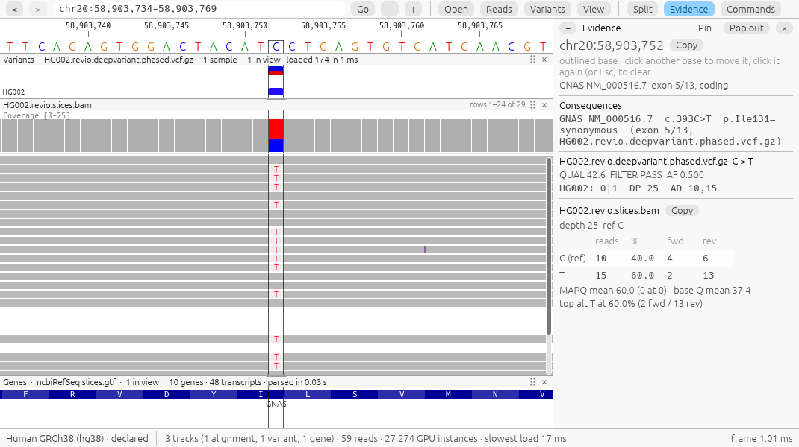
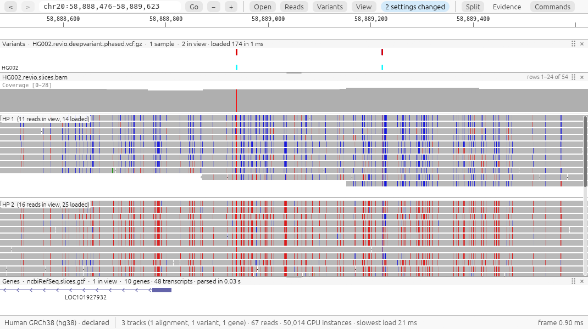
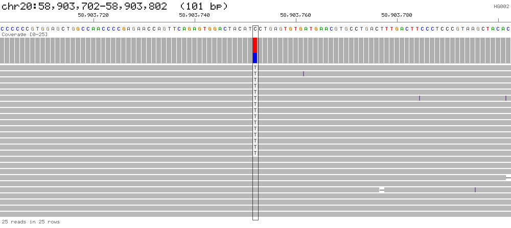

# GGV: Graphic Genome Viewer

GGV is a genome viewer for aligned reads, variants, gene annotations and signal tracks. It has
three interfaces that share one implementation: a desktop application (`ggv-desktop`), a
command-line tool (`ggv`), and a Model Context Protocol server (`ggv mcp`). A query at the same
locus returns the same values from each of them.

[](https://github.com/DylanCosto/ggv/releases/latest)
[](https://github.com/DylanCosto/ggv/actions/workflows/ci.yml)
[](https://github.com/DylanCosto/ggv/blob/main/LICENSE)


*A heterozygous 6.8 kb deletion in PacBio HiFi reads of HG002, grouped by haplotype. The reads
carrying the deletion are all on haplotype 1. This locus is the first step of the demo.*

## Status

Version 0.9 is a beta. It reads local files only. GGV displays and counts what is in the input
files; it does not call variants.

## Components

| Component | Description |
|---|---|
| `ggv-desktop` | Desktop application for BAM/CRAM, VCF/BCF, gene annotations and signal tracks. Rendering takes about 1 ms per frame. |
| `ggv` | Command-line queries at a base or region (TSV or JSON output), headless PNG/SVG rendering, and batch reports over a list of sites. |
| `ggv mcp` | MCP server exposing the same queries. It can attach to a running desktop application and use its current view. |

## Installation

Packages are on the [Releases](https://github.com/DylanCosto/ggv/releases/latest) page.

| System | Package | Requirements |
|---|---|---|
| Windows 10/11 (x64) | `ggv-<version>-windows-x64.zip` | DirectX 12 or Vulkan |
| Linux (x86_64) | `ggv-<version>-linux-x86_64.tar.gz` | glibc 2.35+ (Ubuntu 22.04, Debian 12, Fedora 36 or newer), Vulkan or OpenGL |
| macOS 11+ (Apple silicon and Intel) | `ggv-<version>-macos-universal.zip` | none |

Unpack the archive and run the installer in that folder. Administrator rights are not required.

```sh
powershell -ExecutionPolicy Bypass -File install.ps1   # Windows
./install.sh                                            # Linux and macOS
```

The builds are not code-signed. On Windows the first launch shows a warning; choose
**More info → Run anyway**. On macOS `install.sh` removes the quarantine attribute.
[docs/install.md](https://github.com/DylanCosto/ggv/blob/main/docs/install.md) describes
uninstalling and verifying downloads.

## Demo

`ggv-desktop --demo`, or **Open the demo** in the start window, downloads 4.3 MB of PacBio HiFi
reads from GIAB HG002 on first use. It steps through six examples: a haplotype-specific
deletion, allele counts at a base, methylation, variant review, the command palette and agent
access, and opening other files.

## Desktop application

```sh
ggv-desktop sample.bam chr17:43,044,806 --genome hg38     # built-in reference and genes
ggv-desktop tumor.bam normal.bam calls.vcf.gz genes.gtf.gz BRCA1 -f GRCh38.fa
```

Files can be given in any order. If the last argument is not a file, it is read as a locus or a
gene name. Files can also be dragged onto the window.

### Allele counts

Selecting a base opens the Evidence panel, which counts reads at that position by allele and
strand and shows the matching VCF record and the predicted effect on overlapping transcripts.



### Base modifications

Reads can be coloured by base modification and grouped by haplotype. At the imprinted GNAS
locus below, haplotype 1 is mostly unmethylated (blue) and haplotype 2 mostly methylated (red).



### Other functions

- Sorting, grouping and colouring reads by strand, haplotype, read group or any tag; filtering
  with expressions such as `mapq >= 20 && hp == 1 && !dup`.
- Variant review: stepping through a VCF and labelling each site as real, artifact or unsure.
  Labels are saved next to the VCF.
- Split view for two loci, for example both breakpoints of a rearrangement.
- A command palette (Ctrl+K) that searches commands, genes, bookmarks and recent files. `?`
  lists keyboard shortcuts.
- At chromosome scale, depth is estimated from the index without reading individual records.

[docs/desktop.md](https://github.com/DylanCosto/ggv/blob/main/docs/desktop.md) covers splicing,
structural variants, signal tracks, sessions and reports.

## Command line

```sh
ggv query pileup  sample.bam chr7:55,191,822 -f ref.fa         # one base
ggv query summary sample.bam chr7:55191000-55192000 -f ref.fa  # a region
ggv render sample.bam chr7:55,191,822 -f ref.fa -o snv.png     # image, no display required
ggv batch sites.bed -b tumor.bam -b normal.bam -f ref.fa -v calls.vcf.gz -o review/
ggv index sample.bam                                           # build a missing index
```

Output of `query pileup` at a heterozygous site (some columns omitted):

```text
#contig  pos       ref  depth  A  C   G  T   N  del  ins  ...  alt_fraction  top_alt
chr20    58903752  C    25     0  10  0  15  0  0    0    ...  0.6           T:15
```

The same site rendered with `render --sort base`:



`batch` takes a BED file, a VCF or a list of loci, and writes an image and an HTML report for
each site plus an index page. All queries accept `--format json`.
[docs/cli.md](https://github.com/DylanCosto/ggv/blob/main/docs/cli.md) lists all options.

## MCP server

To register GGV with an MCP client, with default input files:

```sh
claude mcp add ggv -- ggv mcp -b tumor.bam -b normal.bam -f GRCh38.fa -v calls.vcf.gz -g genes.gtf.gz
```

To attach to a running desktop application instead, so that tool calls default to the files and
locus currently displayed:

```sh
claude mcp add ggv -- ggv mcp --attach
```

JSON configuration:

```json
{"mcpServers": {"ggv": {"command": "ggv", "args": ["mcp", "--attach"]}}}
```

Tools return structured data. The `evidence` result for the site above, abridged:

```json
{
  "locus": "chr20:58903752", "ref": "C", "depth": 25,
  "alleles": [
    {"allele": "C", "reads": 10, "forward": 4, "reverse": 6,  "fraction": 0.4, "reference": true},
    {"allele": "T", "reads": 15, "forward": 2, "reverse": 13, "fraction": 0.6}
  ],
  "genes": [{"gene": "GNAS", "transcript": "NM_000516.7", "hgvs_c": "c.393C>T",
             "hgvs_p": "p.Ile131=", "effect": "synonymous", "where": "exon 5/13"}],
  "warnings": []
}
```

| Tool | Returns |
|---|---|
| `evidence` | reads per allele and strand at a base, artifact warnings, the VCF record, the HGVS consequence |
| `reads`, `summarize`, `coverage` | reads grouped by allele, strand or haplotype; region statistics; depth |
| `variants`, `genes`, `consequence` | VCF records, transcripts, and the effect of a given change on a transcript |
| `phase`, `svs`, `repeats`, `junctions` | read-based phasing, structural variants, repeat lengths, splice junctions |
| `compare`, `signal`, `render` | differences between two files (e.g. tumor and normal), signal tracks, images |

When attached to the desktop application, the server can also change the view and display
settings, add bookmarks and overlays, and wait for the user to select a base.
[docs/mcp.md](https://github.com/DylanCosto/ggv/blob/main/docs/mcp.md) lists all tools.

## Supported formats

| Type | Formats |
|---|---|
| Alignments | BAM and CRAM, indexed |
| Variants | VCF and BCF, bgzipped and indexed |
| Annotations | GTF, GFF3 and BED, plain or gzipped |
| References | indexed FASTA (plain or bgzipped) and 2bit |
| Signals | bigWig, bedGraph and SEG |

Missing indexes can be built by the desktop application or with `ggv index`.

Built-in genomes: `--genome hg38` downloads the reference sequence and RefSeq genes on first use
(877 MB for hg38) and caches them. hg19, T2T (hs1), mm39, mm10 and sacCer3 are also available;
hg38 and hg19 include ClinVar and other tracks. See
[docs/genomes.md](https://github.com/DylanCosto/ggv/blob/main/docs/genomes.md).

Not supported yet: remote files (HTTPS, S3), cancelling a load in progress, CRAM with a 2bit
reference.

## Documentation

| Document | Contents |
|---|---|
| [Desktop application](https://github.com/DylanCosto/ggv/blob/main/docs/desktop.md) | alignments, variants, review, splicing, signal tracks, keyboard shortcuts |
| [Command line](https://github.com/DylanCosto/ggv/blob/main/docs/cli.md) | queries, rendering and batch reports |
| [MCP server](https://github.com/DylanCosto/ggv/blob/main/docs/mcp.md) | tool reference, attached mode |
| [Genomes](https://github.com/DylanCosto/ggv/blob/main/docs/genomes.md) | built-in references and tracks |
| [Installation](https://github.com/DylanCosto/ggv/blob/main/docs/install.md) | packages, installers, first run |
| [Development](https://github.com/DylanCosto/ggv/blob/main/docs/development.md) | crates, correctness checks, building |

## Building from source

Requires Rust 1.91 or newer.

```sh
cargo build --release -p ggv-cli -p ggv-desktop
```

This produces `target/release/ggv` and `target/release/ggv-desktop`. Release packaging scripts
are in `scripts/windows`, `scripts/linux` and `scripts/macos`. File parsing is done by
[pasta](https://github.com/DylanCosto/pasta), a Rust library for SAM/BAM/CRAM/VCF/FASTA.

## Bug reports

Use the [issue template](https://github.com/DylanCosto/ggv/issues/new?template=bug_report.yml)
and include the diagnostics from **Commands → About GGV**.

## License

MIT; see [LICENSE](https://github.com/DylanCosto/ggv/blob/main/LICENSE). Third-party components
are listed in
[THIRD_PARTY_NOTICES.md](https://github.com/DylanCosto/ggv/blob/main/THIRD_PARTY_NOTICES.md),
including the MANE transcript list (NCBI/EMBL-EBI, public domain).
