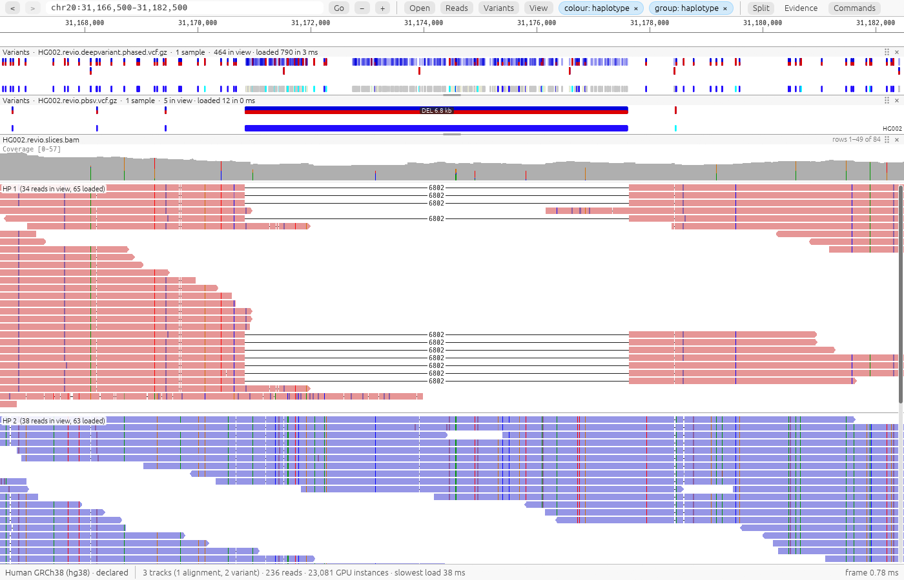

# GGV: Graphic Genome Viewer

A fast genome viewer for people and AI agents. Look at your reads, variants and genes in a
desktop app, ask the same questions from the command line, or let an agent ask them over the
Model Context Protocol (MCP), and get the same numbers every way.



- **Desktop app** (`ggv-desktop`): BAM/CRAM, VCF/BCF, gene annotations and signal tracks, about
  half a millisecond per frame on deep data. Split views, variant review, an exact-count
  Evidence panel at any base, methylation and haplotype views, and whole-chromosome coverage
  from the index.
- **Command line** (`ggv`): pileup and region summaries as TSV or JSON, headless PNG/SVG
  snapshots, and batch reports for a list of sites.
- **Agents** (`ggv mcp`): evidence at a base, HGVS consequences (MANE transcripts), reads,
  phasing, structural variants, repeats and splice junctions as compact JSON. Attached to the
  desktop app, an agent sees what you're looking at, so "is this variant real?" needs no
  coordinates.

GGV 0.9 is a **beta for local files**. Please [report bugs](https://github.com/DylanCosto/ggv/issues/new?template=bug_report.yml)
with the diagnostics from **Commands → About GGV**.

## Install

Download the package for your system from [Releases](https://github.com/DylanCosto/ggv/releases):

| System | Package | Needs |
|---|---|---|
| Windows 10/11 (x64) | `ggv-<version>-windows-x64.zip` | DirectX 12 or Vulkan |
| Linux (x86_64) | `ggv-<version>-linux-x86_64.tar.gz` | glibc 2.35+ (Ubuntu 22.04, Debian 12, Fedora 36 or newer), Vulkan or OpenGL |
| macOS 11+ (Apple silicon and Intel) | `ggv-<version>-macos-universal.zip` | nothing else |

Unzip it, then run the installer in that folder. Nothing needs administrator rights.

```sh
powershell -ExecutionPolicy Bypass -File install.ps1   # Windows
./install.sh                                            # Linux and macOS
```

Unsigned builds trigger a warning the first time: on Windows choose **More info → Run anyway**;
on macOS `install.sh` clears the quarantine for you. Details, uninstalling and checking
downloads: [docs/install.md](https://github.com/DylanCosto/ggv/blob/main/docs/install.md).

## Quick start

Try it on real data first: **Open the demo** on the start screen (or `ggv-desktop --demo`)
downloads 4.3 MB of PacBio HiFi reads of GIAB HG002 once and gives a six-step tour.

```sh
# Desktop: BAMs, variants and genes; the last argument is a locus or a gene name
ggv-desktop tumor.bam normal.bam calls.vcf.gz genes.gtf.gz BRCA1 -f GRCh38.fa
ggv-desktop sample.bam chr17:43,044,806 --genome hg38     # built-in reference and genes

# Command line
ggv query pileup  sample.bam chr7:55,191,822 -f ref.fa --format json
ggv query summary sample.bam chr7:55191000-55192000 -f ref.fa
ggv render sample.bam chr7:55,191,822 -f ref.fa -o snv.png
ggv batch sites.bed -b tumor.bam -b normal.bam -f ref.fa -v calls.vcf.gz -o review/
```

**Agents.** Add GGV to an MCP client with your files as defaults:

```sh
claude mcp add ggv -- ggv mcp -b tumor.bam -b normal.bam -f GRCh38.fa -v calls.vcf.gz -g genes.gtf.gz
```

or attach it to the desktop app, so calls use whatever is on screen:

```sh
claude mcp add ggv -- ggv mcp --attach
```

```json
{"mcpServers": {"ggv": {"command": "ggv", "args": ["mcp", "--attach"]}}}
```

## What it reads

- **Alignments:** BAM and CRAM, indexed (GGV offers to build a missing index).
- **Variants:** VCF and BCF, bgzipped and indexed.
- **Annotations:** GTF, GFF3 and BED, plain or gzipped.
- **References:** indexed FASTA (plain or bgzipped) and 2bit.
- **Signals:** bigWig, bedGraph and SEG.
- **Built-in genomes,** downloaded on first use: hg38, hg19, T2T (hs1), mm39, mm10, sacCer3,
  with RefSeq genes and ClinVar where available.

**Not yet:** remote files (HTTPS, S3), cancelling a slow load, CRAM with a 2bit reference.
GGV shows and counts what's in your files; it isn't a variant caller.

## Documentation

- [Desktop app](https://github.com/DylanCosto/ggv/blob/main/docs/desktop.md): reading alignments, variants, review, splicing, signal tracks, keyboard shortcuts
- [Command line](https://github.com/DylanCosto/ggv/blob/main/docs/cli.md): queries, rendering and batch reports
- [Agents (MCP)](https://github.com/DylanCosto/ggv/blob/main/docs/mcp.md): every tool, and working attached to the desktop app
- [Genomes](https://github.com/DylanCosto/ggv/blob/main/docs/genomes.md): built-in references and tracks
- [Install](https://github.com/DylanCosto/ggv/blob/main/docs/install.md): packages, installers and first run
- [Development](https://github.com/DylanCosto/ggv/blob/main/docs/development.md): crates, correctness checks and building

## Build from source

Rust 1.91 or newer:

```sh
cargo build --release -p ggv-cli -p ggv-desktop
```

The binaries are `target/release/ggv` and `target/release/ggv-desktop`. To package as a
release does, see `scripts/windows`, `scripts/linux` and `scripts/macos`. GGV reads files
through [pasta](https://github.com/DylanCosto/pasta), a pure-Rust library for SAM/BAM/CRAM/VCF/FASTA.

## License

MIT; see [LICENSE](https://github.com/DylanCosto/ggv/blob/main/LICENSE). Bundled open-source components are listed in
[THIRD_PARTY_NOTICES.md](https://github.com/DylanCosto/ggv/blob/main/THIRD_PARTY_NOTICES.md), including the MANE transcript list
(NCBI/EMBL-EBI, public domain).
